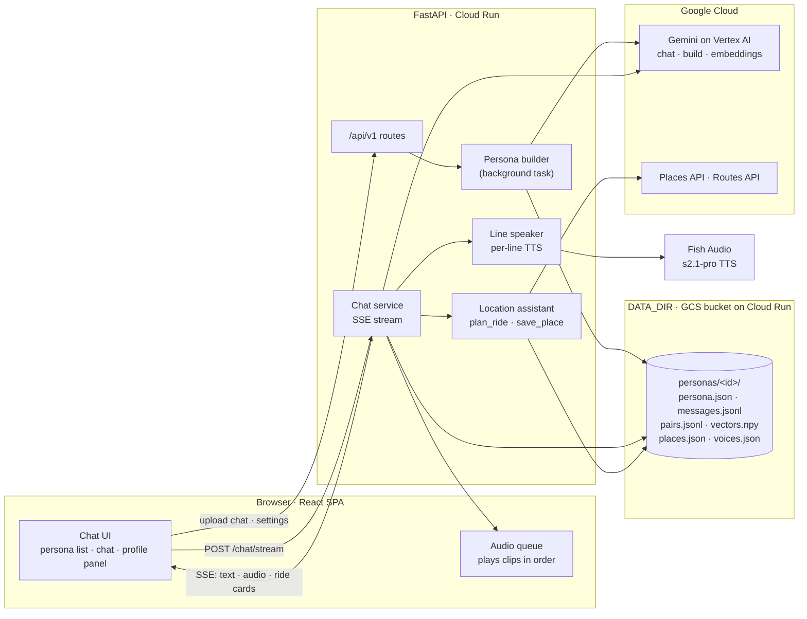
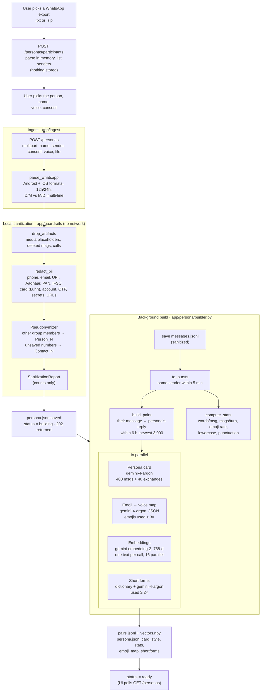
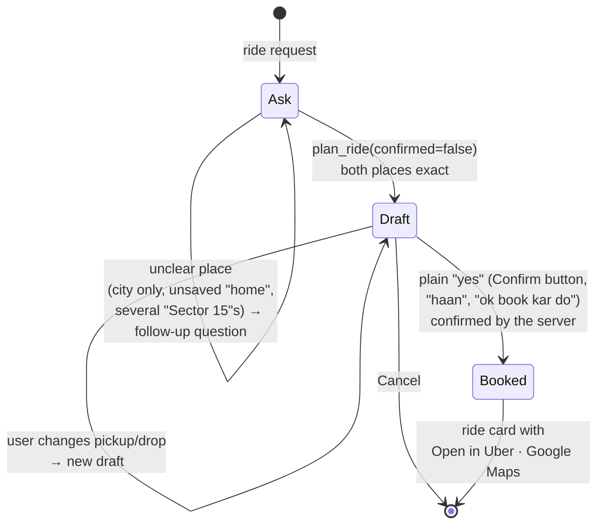

# Architecture: persona building and chat response pipeline

Persona Voice turns a WhatsApp chat export into a **persona**: a chatbot that replies the way a
specific person texts and speaks in an expressive voice. This document explains the two pipelines
behind it:

1. **Persona building**: chat export → sanitized messages → style profile + reply index.
2. **Chat response**: user message → retrieved real replies → streamed reply in the persona's
   style → spoken line by line, with optional ride planning.

The diagrams are Mermaid, so GitHub renders them inline. Product requirements are in
[`docs/requirements/`](../requirements/README.md) and design decisions (D-xxx) in
[`agents/decisions.md`](../../agents/decisions.md).

## System overview



| Concern | Choice |
|---|---|
| Backend | FastAPI (Python 3.13, uv), one service also serving the built SPA |
| LLM | Gemini on Vertex AI via gcloud ADC / the Cloud Run service account, no API key |
| Voice | Fish Audio `s2.1-pro`, S2 bracket cues such as `[laughing]` and `[soft tone]` |
| Retrieval | per-persona flat cosine index in NumPy (`vectors.npy`) |
| Storage | plain files under `DATA_DIR`; a GCS FUSE volume on Cloud Run |
| Streaming | one Server-Sent Events stream per reply, carrying text, audio and cards |

---

## 1. Persona building pipeline

Creating a persona takes two requests. The raw export only exists in memory and is **never written
to disk**.



### What each build artefact is used for

| Artefact | Built by | Used at reply time for |
|---|---|---|
| **Reply pairs + vectors** | `pairs.py`, `builder._embed_pairs` | the 12 real replies most similar to the user's message go into the prompt as examples |
| **Persona card** | Gemini (`CARD_PROMPT`) | bullet-point personality: language mix, quirks, humour, reactions, "never says" |
| **Style stats** | `stats.py` (deterministic) | hard constraints in the prompt, e.g. "typical message: 3 words" |
| **Emoji map** | Gemini (`EMOJI_PROMPT`) | that person's meaning of each emoji → Fish cue, e.g. 😂 → `[chuckling]` |
| **Short forms** | dictionary + Gemini (`SHORTFORM_PROMPT`) | spoken in full ("kb" → "kab"); shown in full only if the user turns that on |
| **Sanitization report** | guardrails | profile panel's privacy summary |

Failures in emoji or short-form detection don't stop the build. A failure anywhere else sets
`status = failed`. A voice changed during the build is kept, and a persona deleted during the build
isn't recreated.

---

## 2. Chat response pipeline

Each user message opens one SSE stream. Text arrives as it's generated, each finished line is sent
to Fish Audio straight away, and its audio follows in the same stream.

```mermaid
sequenceDiagram
    autonumber
    actor U as User
    participant SPA as React SPA
    participant API as POST /chat/stream
    participant RET as Pair index
    participant LLM as Gemini
    participant LOC as Location tools
    participant SPK as Line speaker
    participant FISH as Fish Audio

    U->>SPA: types a message
    SPA->>API: persona_id, last 20 turns, speak, pending_ride?
    API->>LLM: embed the user's message (gemini-embedding-2)
    API->>RET: cosine search → top 12 real replies (deduplicated)
    Note over API: System prompt = persona card + style stats<br/>+ 12 "Them: … / Name: …" examples<br/>+ rules (stay in character, no AI talk)<br/>+ location rules and saved place labels
    API->>LLM: stream reply (3.5-flash with tools,<br/>3.5-flash-lite without)

    loop text chunks
        LLM-->>API: chunk
        API->>API: strip echoed "Name:" prefix
        API-->>SPA: event: delta
        alt a line just finished and speak is on
            API->>SPK: line
            SPK->>SPK: output guard → expand short forms → emoji → cues
            SPK->>FISH: TTS: first line at once, later lines merged (≤ 2 calls at a time)
        end
        opt model calls a tool (≤ 3 rounds)
            LLM-->>API: plan_ride / save_place
            API->>LOC: execute
            LOC-->>SPA: event: ride_preview · location · choices · saved_place
            LOC-->>LLM: result (labels only, never saved addresses)
        end
        FISH-->>SPK: mp3 for that line
        SPK-->>SPA: event: audio (index, base64), in order
    end

    API-->>SPA: event: done (guarded bubbles, tts_text)
    SPK-->>SPA: remaining audio events
    SPA->>U: final text; clips trimmed, levelled and played gaplessly
```

### Step by step

1. **Retrieve.** The user's message is embedded and compared with the contexts of the persona's
   real reply pairs. The 12 closest replies (duplicates removed) become the examples. The demo
   persona has hand-written examples instead.
2. **Prompt.** `reply_system()` in `app/llm/prompts.py` combines the persona card, measured style,
   the examples and the rules. With location assist on, it adds the ride rules, saved place labels
   and any pending ride draft.
3. **Generate.** Gemini streams the reply. Without location assist, a plain stream from
   `gemini-3.5-flash-lite` (minimal thinking) is used. With it (the default), `gemini-3.5-flash`
   runs with the tools `plan_ride` and `save_place`; flash-lite skipped tool calls in testing. An
   empty reply is retried once, and rate limits (429) are retried before the first chunk.
4. **Clean up.** `PrefixStripper` removes a leading `Name:` that the model sometimes echoes from the
   examples. The final text goes through `guard_reply`, which removes any PII the model produced and
   placeholders such as `[PHONE]` or `Person_2`.
5. **Speak while streaming** (`app/chat/speaker.py`). Each completed line is guarded, its short
   forms are expanded, and emojis are turned into Fish cues using the persona's emoji map. The
   **first line** is synthesized immediately so the voice starts fast. **Later lines are merged
   into one clip**, with full stops between bubbles, so the voice keeps one tone instead of
   restarting at every bubble; very long replies are split at about 220 characters. Clips are
   emitted strictly in order, and a failed clip becomes `audio_error` without stopping the others.
6. **Play smoothly** (`frontend/src/audioQueue.js`). The browser decodes each clip with Web Audio,
   trims the silence Fish adds at the edges, levels its loudness, fades the edges to avoid clicks,
   and schedules the clips back to back with a fixed 140 ms pause.
7. **Finish.** `done` carries the final bubbles and the full voice script. If the client
   disconnects, pending TTS calls are cancelled.

### Emoji → voice cues (`app/speech/cues.py`)

| In the reply | Spoken as | Rule |
|---|---|---|
| `haan pakka 😂` | `[joking] haan pakka` | a single laugh emoji next to text is a joking tone |
| `haan pakka 😂😂` | `[laughing] hahaha haan pakka` | two or more give a real laugh, and sound effects get matching text |
| `😂` | `[laughing] hahaha` | an emoji on its own is spoken, not dropped |
| `BHAI 🔥🔥🔥` | `[very excited] BHAI` | three repeats raise the intensity |
| `kya hua 🫂` | `[soft tone][empathetic] kya hua` | the persona's own emoji map wins over the defaults |

Cues always go at the start of the sentence, at most 3 per sentence, using S2 bracket syntax.

### Location assist: ask, draft, confirm



- Places are resolved on the server in this order: saved label → `place_id:` → Places text search →
  a check for ambiguous areas across NCR cities → "too broad" if the result is a whole city.
- Drafts are kept by the client (`pending_ride`) and sent back with the next message, so "haan"
  confirms exactly the places the user checked. The server confirms a plain yes itself rather than
  relying on the model to call the tool.
- The model sees only labels such as "home". Saved addresses go to Google Maps and to the UI, never
  to Gemini.

---

## SSE event reference (`POST /api/v1/chat/stream`)

| Event | Payload | When |
|---|---|---|
| `delta` | `{text}` | streamed text chunks |
| `done` | `{bubbles, tts_text}` | final guarded text (replaces the deltas) and the voice script |
| `error` | `{message}` | the model failed; no message text is logged |
| `audio` | `{index, format, audio}` | base64 mp3 for line `index`, in order (when `speak: true`) |
| `audio_error` | `{index, message}` | TTS failed for one line |
| `ride_preview` | ride card + `draft` refs | ride drafted, waiting for confirmation |
| `location` | ride card + `uber_url`, `maps_url` | ride confirmed |
| `choices` | `{options}` | tap-to-answer options, e.g. which Sector 15 |
| `saved_place` | `{label, name, address}` | a place was saved (e.g. home) |

## Data on disk (`DATA_DIR`)

```
data/
├── personas/
│   ├── <id>/
│   │   ├── persona.json        card, style, stats, emoji_map, shortforms, voice_id, report
│   │   ├── messages.jsonl      sanitized messages (for rebuilding and re-detecting short forms)
│   │   ├── pairs.jsonl         context → reply pairs
│   │   └── vectors.npy         embeddings of the pair contexts (float32, 768-d)
│   └── builtin_overrides.json  user changes to the demo persona (voice, short forms)
├── places.json                 saved places (home, office…): personal data, local only
└── voices.json                 custom Fish voices added by ID
```

## Privacy boundaries

| Data | Leaves the server? |
|---|---|
| Raw chat export | Never stored; parsed in memory |
| Sanitized messages | Sent to Gemini (persona card, emoji map, short forms, embeddings) |
| Saved place addresses | Sent to Google Maps only; Gemini sees labels such as "home" |
| Reply text | Sent to Fish Audio for speech, after the output guard |
| Logs | IDs, counts and timings only, never message text |

Not built yet: the sensitive-topic classifier and name detection for people who are only mentioned in
messages. See [`privacy-and-guardrails.md`](../requirements/privacy-and-guardrails.md).

## Where things live

| Path | Responsibility |
|---|---|
| `app/ingest/whatsapp.py` | export parsing |
| `app/guardrails/` | artifacts, PII, pseudonyms, sanitization report, output guard |
| `app/persona/builder.py` | build orchestration (stats, pairs, card, emoji map, embeddings, short forms) |
| `app/persona/{pairs,stats,index,shortforms}.py` | the individual build steps and the retrieval index |
| `app/storage/personas.py` | the on-disk persona store |
| `app/llm/client.py`, `prompts.py` | Gemini client (stream, tool turns, JSON, embeddings, retries) and every prompt |
| `app/chat/service.py` | the response pipeline and tool loop |
| `app/chat/speaker.py` | per-line speech while streaming |
| `app/speech/` | emoji → cue conversion, Fish TTS client, voice catalog |
| `app/location/` | Places and Routes client, place resolution, ride tools, saved places |
| `frontend/src/` | React SPA (`App.jsx`, `components/`, `audioQueue.js`) |

Measured latencies (warm, from development testing):
- Chat: first text about 0.9–1.6 s; each line's audio 0.3–0.6 s after the line is written.
- Persona build: about 13 s for 650 messages.
- Ride draft: about 3–4.5 s including the Google calls.
